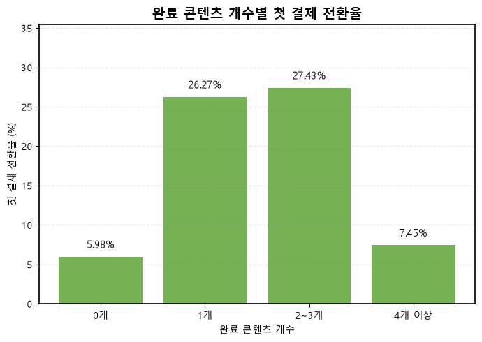
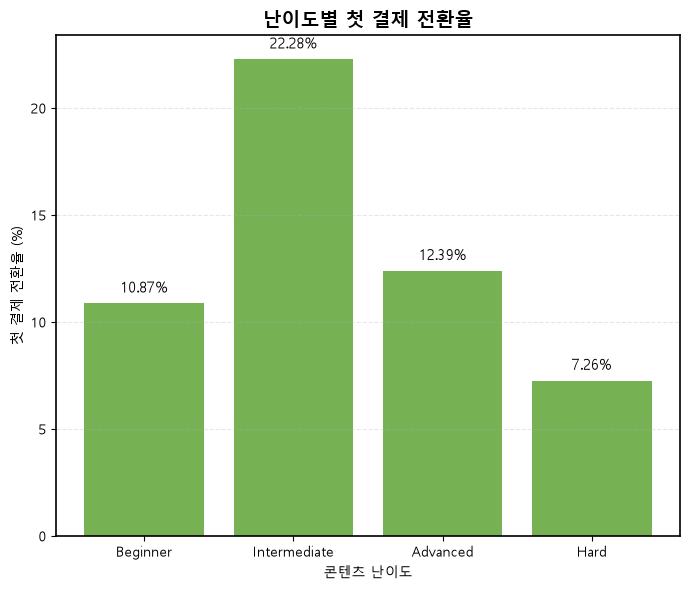

# 온라인 교육 구독 서비스 첫 결제 전환 분석

> 신규 가입자의 첫 결제 전환율은 8.60%에 그쳤지만, 콘텐츠를 1-3개 완료한 사용자의 전환율(26.27-27.43%)은 미완료 사용자(5.98%)보다 4배 이상 높았다.

- 📄 [분석 보고서 (PDF)](reports/report.pdf) · 📊 [발표자료 (PDF)](reports/presentation.pdf) · 📓 [분석 노트북](notebooks/edu_subscription_conversion_analysis.ipynb)
- **기간**: 2026.07.16 – 2026.08.11
- **인원**: 팀 6인 (강성재, 박고은, 우지연, 장선민, 전재원, 조진항)
- **도구**: SQL (MySQL), Python (pandas, SQLAlchemy, matplotlib), Google Colab

## 문제 정의

2022-2023년 가입한 신규 회원 145,133명 중 첫 결제까지 도달한 비율은 8.60%로, 신규 가입자의 91.4%가 유료 고객으로 전환되지 못하고 있었습니다.
특히 2023년 4월 무료체험 제도가 폐지되면서 결제 전 콘텐츠를 경험할 수 있는 접점은 무료레슨뿐이었습니다.
신규 사용자의 콘텐츠 경험이 첫 결제와 어떤 관계가 있는지 확인해 전환율을 높일 요인을 찾고자 했습니다.

## 분석 과정

- **데이터 정제**: 17개 이벤트 로그 테이블에서 완전 중복행을 제거하고, `client_event_time`을 datetime(0)으로 통일한 뒤 식별 가능한 신규 사용자 기준으로 분석했습니다.
- **사용자·서비스 이용 특성 파악**: 기기·국가·로그인 방식별 가입자 분포와 레슨 수강 기준 DAU/MAU, 시간대별 이용 추이를 확인했습니다.
- **퍼널 설계와 병목 탐색**: 가입·무료체험·학습·구독 4개 퍼널의 핵심 지표를 산출하고, 개선 여지가 가장 큰 `회원가입 → 결제페이지 진입 → 첫 결제`를 메인 퍼널로 정했습니다. (분석 기간 2022.11.03-2023.12.10)
- **세그먼트 분석**: 메인 퍼널 단계별 그룹(결제페이지 미진입 / 진입 후 미결제 / 첫 결제)에 대해 콘텐츠 시작·완료율, 완료 콘텐츠 개수, 콘텐츠 난이도, 무료레슨 시청 여부·시점·개수에 따른 첫 결제 전환율을 비교했습니다.

## 핵심 결과

  
  

- **콘텐츠를 완료한 경험이 첫 결제와 밀접했습니다.** 첫 결제 그룹의 콘텐츠 완료율(24.55%)은 결제페이지 미진입 그룹(4.96%)의 4.95배, 진입 후 미결제 그룹(7.43%)의 3.30배였습니다.
- **콘텐츠를 1-3개 완료했을 때 전환율이 가장 높았습니다.** 0개 5.98%, 1개 26.27%, 2-3개 27.43%였고, 4개 이상은 7.45%로 다시 낮아졌습니다.
- **Intermediate 난이도의 완료율(42.74%)과 첫 결제 전환율(22.28%)이 가장 높았습니다.** 하지만 무료레슨 4개 콘텐츠는 Beginner 3개, Advanced 1개로 구성되어 Intermediate는 빠져 있었습니다.
- **가입 직후 1분 이내에 무료레슨을 시청한 그룹의 전환율은 4.22%로, 무료레슨 미시청 그룹(7.28%)보다도 낮았습니다.** 1분 이후 시청을 시작한 그룹은 11-17%대였습니다.

## 제안

1. **무료레슨 완주를 유도하는 학습 흐름 설계**: 개인화된 첫 콘텐츠 추천, 진행도 표시, 완료 직후 다음 레슨 추천, 완주 배지·리워드 등을 통해 하나의 콘텐츠를 끝까지 경험하도록 유도합니다.
2. **'사용자 주도형' 콘텐츠 탐색 환경 조성**: 자동 재생이나 강제 노출 대신 관심 분야와 학습 수준을 고르는 온보딩으로 맞춤형 콘텐츠를 추천합니다.
3. **Intermediate 난이도 무료레슨 도입**: 전환율이 가장 높은 Intermediate 콘텐츠의 일부를 무료로 공개합니다.

> 본 분석은 로그 데이터 기반의 연관성 분석이므로, 각 제안은 A/B 테스트로 효과를 검증한 뒤 적용할 것을 전제로 합니다.

## 내 역할

- DAU/MAU 추이 분석
- 메인 퍼널(회원가입 → 결제페이지 진입 → 첫 결제) 설계
- 콘텐츠 난이도별 결제전환율 분석
- PPT 제작

## 한계와 배운 점

**한계**
- 관찰 종료일(2023.12.10)에 가까운 가입자는 후속 행동을 관찰할 기간이 짧아 전환율이 실제보다 낮게 집계됐을 수 있습니다.
- 콘텐츠–레슨 구성 관계 테이블이 없어, 콘텐츠·레슨 개수는 관찰 기간 내 1회 이상 접근된 항목 기준으로 산출했습니다.
- 메인 퍼널을 거친 결제자(7,522명 중 6,696명, 89.0%)만 분석했고, 결제페이지를 거치지 않은 826명은 제외됐습니다.
- 체류 시간, 요금제 가격, 할인 정책, UTM 파라미터 정보가 없어 유입 경로나 가격 요인은 분석하지 못했습니다.
- 콘텐츠 경험과 결제의 관계는 연관성이며 인과관계로 해석할 수 없습니다.

**배운 점**
- 무료레슨을 "봤는지" 여부만으로는 전환 차이가 거의 없었지만(7.56% vs 7.28%), 시청 시점과 시청 개수로 쪼개자 차이가 드러났습니다. 지표를 한 단계 더 세분화해야 실제 행동의 의미가 보인다는 점을 배웠습니다.
- 분석 기간 중 무료체험 폐지 같은 서비스 구조 변화가 있으면, 테이블별 수집 기간과 정책 시점을 먼저 맞춰야 분석 기간을 일관되게 설정할 수 있었습니다.

## 데이터

부트캠프 제공 데이터로, 외부 공유 금지에 따라 포함하지 않았습니다.

- 온라인 교육 구독 서비스의 이벤트 로그 (2022.01.01 - 2023.12.31)
- 총 17개 이벤트 로그 테이블 (회원가입 완료, 결제페이지 진입, 콘텐츠 시작·완료, 무료체험 시작, 첫 결제·정기 결제 등)
- 각 테이블은 12개 공통 컬럼과 이벤트별 컬럼으로 구성되며, MySQL에 적재해 SQL로 집계했습니다.
